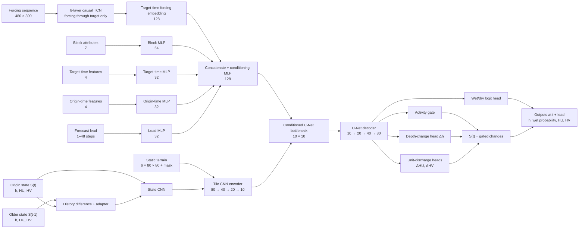

# Triton Lite Flood Forecasting

This repository is now organized around **Stage 2 V5**, a state-aware flood
forecasting system for direct 0.5-to-24-hour prediction of 10 m depth, flood
extent, and flow fields over the Conasauga simulation domain.

Start with [PROJECT_GUIDE.md](PROJECT_GUIDE.md). The frozen V5 experiment
contract and promotion sequence are in
[docs/stage2/STAGE2_V5_PLAN.md](docs/stage2/STAGE2_V5_PLAN.md).

## Active model

V5-A predicts a requested future state in one model application:

```text
observed states S(t), S(t-1)
+ terrain and block attributes
+ forcing known through t + lead
+ requested lead of 1...48 half-hour steps
    -> depth, wet probability, HU, HV at t + lead
```

The direct forecast avoids recursively feeding 48 predictions back into the
model. Later controlled experiments add input halos, block-specific forcing,
a hierarchical tile/HUC12 graph, and conservation constraints. Each addition
must beat V4b and persistence on the same forecast origins and metrics.

### Implementation status

V5 is currently the **V5-A direct tile model**, not a graph neural network.
Items 1 and 2 of the seven-part experiment sequence are complete.

| Experiment | Status | What exists now |
|---|---|---|
| V4b component-policy diagnostics | Complete | Learned, velocity-persistent, and HU/HV-persistent rollouts through 24 h |
| V5-A direct lead model | Complete | Training, checkpoint selection, and dense 1–48-step evaluation |
| V5-B input halos | Not implemented | Next isolated spatial-context experiment |
| V5-C block-specific forcing | Not implemented | Planned aggregation/cross-attention |
| V5-D multiscale graph | Not implemented | Planned tile and HUC12 message passing |
| V5-E conservation/coupling | Not implemented | Planned mass and boundary-flux constraints |
| V5-F Transformer/operator | Not implemented | Deferred controlled backbone comparison |

### V5-A model structure



One sample represents one `80 × 80` tile. V5-A processes that tile independently;
it has no neighboring-tile messages, HUC12 nodes, graph edges, or boundary-flux
exchange. Those enter only in V5-B through V5-E.

### Current V5-A result

The completed checkpoint selected epoch 4 using fixed validation leads. On the
dense D030 development cohort, V5-A beats full-state persistence at 47 of 48
wet-depth horizons, 44 of 48 wet-F1 horizons, and 46 of 48 physical-score
horizons. Selected leads include:

| Lead | V5-A depth RMSE | Persistence | V5-A wet F1 | Persistence |
|---:|---:|---:|---:|---:|
| 0.5 h | 0.3217 m | 0.3682 m | 0.9553 | 0.9515 |
| 6 h | 0.7152 m | 0.7422 m | 0.9134 | 0.9018 |
| 12 h | 0.9355 m | 0.9617 m | 0.8667 | 0.8511 |
| 24 h | 0.8304 m | 0.8989 m | 0.8544 | 0.8359 |

Derived-velocity RMSE beats persistence at only 2 of 48 horizons, so V5-A is a
promising depth/extent baseline rather than the final model. D030 has also
informed model development and is not a pristine final test event.

## Repository layout

```text
├── stage2/                    # active V5 model, data adapters, train/evaluate code
├── triton_core/               # shared active data, encoder, metrics, runtime
├── workflows/stage2/          # active V5 and V4b-diagnostic Slurm jobs
├── docs/stage2/               # active model and experiment documentation
├── data_preprocessing/        # shared TRITON/event/static-data preparation
├── tests/                     # active Stage-2 regression tests
├── archive/stage1/
│   ├── code/                  # frozen Stage-1 implementations
│   ├── docs/                  # Stage-1 reports and architecture records
│   ├── workflows/             # Stage-1 and transition Slurm workflows
│   ├── tests/                 # isolated Stage-1 regression tests
│   ├── PROJECT_GUIDE.md       # archived Stage-1 navigation
│   └── README.md              # archived Stage-1 project description
└── results/                   # checkpoints and metrics, retained in place
```

There are no Stage-1 modules at the repository root. Complete historical
implementations live under `archive/stage1/code/`; reusable active components
were extracted into `triton_core/`.

## Current data scope

- 40 TRITON events
- 480 half-hour states and 240 hours per event
- one Conasauga regional simulation domain
- 34 HUC12 subwatersheds
- approximately 6,900 spatial tiles
- `80 x 80` cells per tile at 10 m resolution
- 300 forcing locations

This supports controlled in-domain V5 development. Operational or cross-region
claims require newly generated untouched events and additional regional domains.

## Verification

Use the project environment and run:

```bash
python -m unittest discover -s tests
bash -n workflows/stage2/*.sh
```

Stage-1 checkpoints and result directories have not been moved because they
remain comparison inputs for Stage 2.
