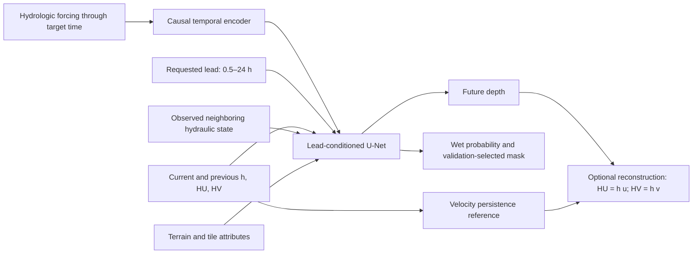
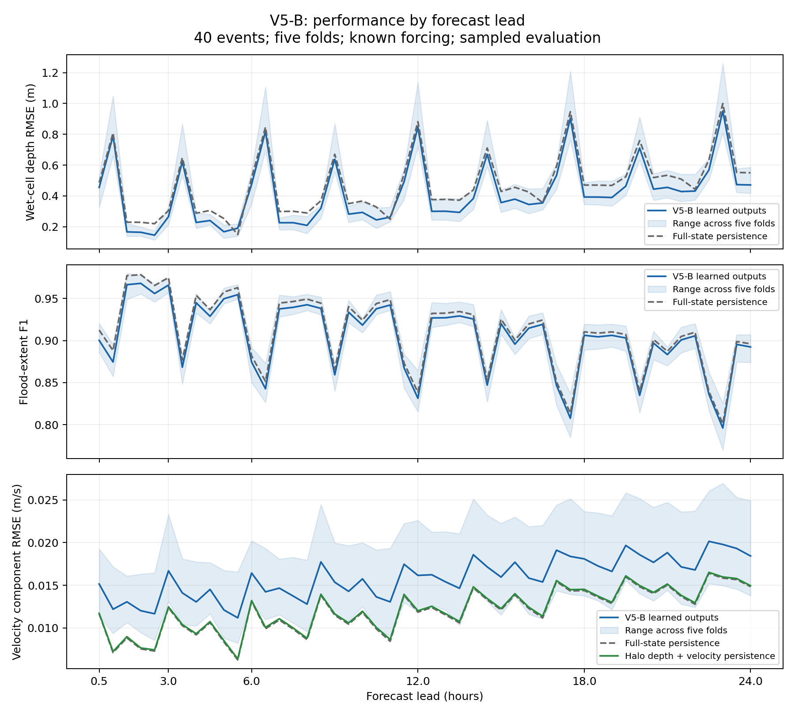

# Flood Forecasting: Leadership Briefing

Prepared 5 October 2026. Evidence: completed V5-B five-fold evaluation and
three-seed experiments on fold 0. Proposed compute platform: OLCF Riker.

## Decision requested

Support a focused improvement and validation phase built around the **direct,
state-aware U-Net with hydraulic neighborhood inputs**. Use persistence as
the velocity reference. Define the intended use and acceptable depth error,
missed flooding, false alarms, runtime, and forcing assumptions before choosing
an operational model.

The model is a promising depth surrogate. Its current extent and learned
velocity outputs do not yet justify operational deployment. Graphs and newer
backbones remain experiments with explicit entry criteria.

## Presentation outline

| Slide | Main message | Evidence or visual |
|---|---|---|
| 1. Objective | Forecast flood maps at every half-hour lead through 24 hours | Explain required current hydraulic state and future forcing |
| 2. Proposed model | Direct U-Net with terrain, state history, forcing, and neighboring hydraulics | Architecture diagram below |
| 3. Evaluation | Hold out complete storms; compare with copying the current state | 40 events, five folds, identical origins across leads |
| 4. Results | Neighborhood model improves depth; velocity remains a weakness | Five-fold table and lead curves |
| 5. What we learned | More components did not automatically improve performance | Ablation decisions and risks |
| 6. Plan and leadership decisions | Improve evidence and formulation, then add complexity if warranted | V5-B–F gates and resource needs |

## Task and proposed model

At time `t`, provide depth `h`, unit discharges `HU, HV`, one preceding state,
terrain and tile attributes, and hydrologic forcing through `t + lead`. The
model produces the requested future map in one forward pass. A 24-hour
prediction does not recursively feed 48 predicted states back into itself.

Each tile is 80 × 80 cells, approximately 0.8 × 0.8 km. The domain contains
approximately 6,900 tiles and 34 HUC12 subwatersheds. A tile is a raster patch,
not a whole watershed. Current outputs have approximately 10 m resolution.

For development we retain learned discharge heads to measure progress. The
current evidence favors observed-velocity persistence over those learned
outputs. Reconstructing discharge from predicted depth and persistent velocity
must be evaluated jointly; individually selected output policies do not guarantee
a physically consistent forecast.

Known future forcing is an input requirement, not a weather prediction made
by this model. Real operation needs forecast forcing and uncertainty tests.

## Experimental evidence

- 40 TRITON events, each 240 hours long with 480 half-hour states.
- Five complete-event folds: each event is tested once; each run uses 25
  training events, seven validation events, and eight test events.
- Five-fold results use seed 45. Three-seed baseline/halo/gate experiments
  were completed on fold 0 only.
- Train from scratch: no checkpoint previously trained on the new test folds
  initializes the models.
- Ten epochs, 750 batches per epoch, eight tiles per training batch; leads
  sampled from 1–48 steps.
- Checkpoints selected on validation leads 0.5, 3, 6, 12, and 24 hours.
- Extent rules and thresholds selected on validation events only.
- Dense tests cover every lead from 0.5 to 24 hours using 80 sampled batches
  per fold, with identical forecast origins across leads.

Persistence means copying the observed state at the forecast origin to the
future target. It is a strong reference where hydraulic changes are small.

## Five-fold results

These are equal-weight averages of five fold-level means across all 48 leads.
They are not a single pooled-pixel RMSE and are not 12-hour-only results.

| Measure | V5-B learned outputs | Full-state persistence | Interpretation |
|---|---:|---:|---|
| Wet-depth RMSE | **0.4202 m** | 0.4762 m | 11.8% improvement |
| All-cell depth RMSE | **0.0977 m** | 0.1015 m | 3.7% improvement |
| Wet F1 | 0.9034 | **0.9098** | Extent remains below reference |
| Wet recall | 0.9243 | **0.9369** | More missed wet cells |
| Dry specificity | 99.729% | 99.727% | Essentially tied |
| HU/HV RMSE | 0.02719 | **0.02705** | Essentially tied |
| Velocity RMSE | 0.01591 m/s | **0.01198 m/s** | Learned velocity 32.8% worse |

Using persistent velocity with learned depth yields velocity RMSE 0.01212 m/s,
close to full-state persistence. Shallow-water clamping and reconstruction affect
the measured derived velocity; this does not establish learned velocity skill.

Depth improves in all five folds and in 30 of 40 events. Within each fold,
it beats persistence at 44–48 of the 48 leads. Ten events still deteriorate.
Across fold-level horizon averages, wet-depth RMSE standard deviation is
0.0510 m. This is variation across folds, not a confidence interval.

### Lead-specific results

| Lead | V5-B wet-depth RMSE | Persistence | Relative improvement | V5-B F1 | Persistence F1 |
|---:|---:|---:|---:|---:|---:|
| 0.5 h | 0.455 m | 0.487 m | 6.5% | 0.900 | 0.912 |
| 1 h | 0.790 m | 0.809 m | 2.3% | 0.874 | 0.888 |
| 2 h | 0.164 m | 0.229 m | 28.3% | 0.968 | 0.978 |
| 3 h | 0.265 m | 0.304 m | 12.8% | 0.966 | 0.975 |
| 6 h | 0.476 m | 0.518 m | 8.1% | 0.874 | 0.882 |
| 12 h | 0.848 m | 0.882 m | 3.9% | 0.831 | 0.838 |
| 18 h | 0.393 m | 0.471 m | 16.5% | 0.906 | 0.910 |
| 24 h | 0.472 m | 0.550 m | 14.3% | 0.892 | 0.896 |

The irregular horizon curve also occurs in persistence. Audit target dynamics,
time alignment, and sparse sampling before interpreting it as intrinsic model
behavior. A lower 24-hour error than 12-hour error does not prove longer leads
are easier in general.

## Advantages and current limitations

| Advantages | Limitations |
|---|---|
| Depth gains across all five event folds | Ten events worsen relative to persistence |
| Direct prediction avoids recursive error accumulation | Requires an observed/estimated initial hydraulic state |
| Spatial terrain and neighboring hydraulic inputs | Forcing uses one global representation |
| Existing pipeline and reproducible checkpoints | Future forcing is assumed known |
| Explicit persistence reference and event splitting | Dense evaluation samples only 80 batches per fold |
| Works with existing Python environment | Runtime and throughput must be measured on Riker |

High dry specificity should not be presented as total forecasting accuracy:
only roughly 2% of evaluated cells are wet, so dry dominance makes that metric
easy to inflate. Report wet recall and wet-cell depth alongside it.

The original halo experiment also adds encoder capacity. A matched-capacity
control is needed to isolate the effect of neighboring information. The current
96 × 96 hydraulic input is cropped after two 3 × 3 convolutions. At inference,
its direct spatial dependence extends approximately two cells outside the tile;
the full eight-cell border is not yet used by the full encoder.

## Roadmap with decision gates

| Stage | Status and next experiment | Question and promotion gate |
|---|---|---|
| V5-B: spatial context | Depth evidence complete; audit horizons, expand cohort, add capacity control and retain halo through encoder | Are gains consistent across events, leads, and boundary cells? |
| V5-C: local forcing | Initial inverse-distance signal tested with unsuccessful coupling losses; no clean rejection of local forcing | Test halo versus halo + upstream/relevant forcing under identical loss; require improvement without material extent/velocity regression |
| V5-D: graph | Not implemented | Add tile adjacency/upstream communication if residual errors show distant propagation; start small before hierarchical 6,900-tile + 34-HUC12 graph |
| V5-E: hydraulic coupling | Auxiliary losses and component gate tested; velocity improvement insufficient | Test wetting/drying consistency and adjacent-tile flux accounting with known source terms; require velocity and mass-budget gains |
| V5-F: Transformer/operator | Deferred | Compare only after inputs and output semantics are correct; require benefit against matched U-Net at measured compute cost |

Stages are hypotheses, not mandatory additions. Extent consistency belongs in
the immediate work even though broader conservative modeling is labeled V5-E.
The simplest formulation meeting agreed accuracy and runtime targets wins.

### Immediate work sequence

1. Freeze the existing results as a reference and verify time alignment,
   target behavior, and repeated spatial sampling behind the horizon curve.
2. Improve evaluation coverage; report phase, severity, boundaries, shallow
   water, moving water, and per-event failure cases with event-level uncertainty.
3. Test a full-context halo and a matched-capacity no-neighbor control.
4. Test dry-depth suppression and depth/extent consistency.
5. Run a clean V5-C forcing experiment. Use failure patterns to decide on V5-D.
6. Measure learning curves using nested training-event subsets; generate more
   events if performance or uncertainty remains limited by storm diversity.
7. Freeze the chosen model and test newly generated untouched events and
   forecast-forcing perturbations before an operational claim.

## Leadership decisions and resource plan

Agree on the primary use: flood screening, depth mapping, or velocity-sensitive
hazard decisions. Establish lead-specific acceptable errors and missed-flood
rates; 0.42 m average wet-depth RMSE has different implications for each use.
Confirm how current hydraulic states and future forcing will be obtained.

Use Riker for the next experiments with the existing `triton_andes` environment.
The environment name is historical. Verify GPU compatibility, queue limits,
and throughput on Riker before converting Andes runtimes into calendar or
budget commitments. Prioritize controlled experiments and targeted new event
generation over an immediate large-backbone investment.

## Evidence and artifacts

- [Five-fold numerical results](../../results/stage2_v5b_crossval/CROSSVAL_RESULTS.md)
- [Machine-readable results](../../results/stage2_v5b_crossval/CROSSVAL_SUMMARY.json)
- [Detailed V5-B experiment report](V5B_EXPERIMENT_REPORT.md)
- [Figure PDF](figures/v5b_forecast_horizons.pdf)
- [All-lead CSV](figures/v5b_forecast_horizons.csv)

Suggested opening statement: **We have demonstrated better depth forecasting
over the known domain. We are keeping that improvement while addressing missed
flooding and weak learned velocity through controlled experiments. The next
investment buys stronger validation and relevant inputs before a larger model.**
