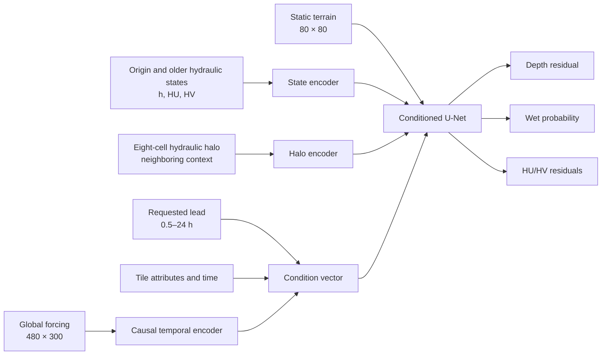

# V5-B Hydraulic-Halo Experiment Report

> **Superseded scientific interpretation, 6 October 2026:** confirmed target
> conversion defects invalidate the intended chronological forecast evaluation.
> Results below are preserved as legacy pipeline records, not validated model
> skill. See [target-data audit](TARGET_DATA_AUDIT.md) before using these tables.

Updated 5 October 2026. Five-fold confirmation is complete. See the
[leadership briefing](LEADERSHIP_BRIEFING.md) for the current recommendation,
lead-specific figures, and roadmap, and the
[five-fold results](../../results/stage2_v5b_crossval/CROSSVAL_RESULTS.md)
for the numerical summary. Execution has moved to
[OLCF Riker](RIKER_EXECUTION.md) with the existing Python environment.

The fold-0 results below are historical development evidence. Across all five
folds, wet-depth RMSE is **0.4202 m versus 0.4762 m persistence (11.8% better)**,
wet F1 is **0.9034 versus 0.9098**, and learned velocity RMSE is **0.01591 versus
0.01198 m/s**. Persistent velocity with learned depth gives **0.01212 m/s**.
Depth improves in all folds and 30 of 40 events. Five-fold testing uses one
seed per fold; the three-seed study remains limited to fold 0.

## Executive summary

V5-B tests whether a direct 0.5–24-hour flood surrogate improves when each
80 × 80 target tile can see an eight-cell hydraulic border outside that tile.
The controlled three-seed fold-0 experiment shows that the halo is a robust
depth improvement, but not a complete improvement for flood extent or velocity.

- Wet-cell depth RMSE improves from 0.4245 m to 0.3780 m relative to the
  matched learned baseline: **10.9% better**.
- Relative to full-state persistence (0.4627 m), V5-B depth is **18.3% better**.
- Halo depth beats persistence at 45–47 of 48 horizons in every seed.
- Wet F1 decreases from 0.9121 to 0.9036; persistence is 0.9140.
- Learned derived-velocity RMSE is 0.01362 versus 0.01058 for persistence.
- A persistence-biased component gate improves velocity only 1.7% over the
  ordinary halo model and remains 26% worse than persistence.

The promoted scientific candidate is therefore **halo depth**, not the complete
multi-output halo model. Extent-rule diagnostics and five-fold event evaluation
are complete and still show weaker extent and learned velocity than persistence.
Velocity persistence remains the reference policy. A matched-capacity control
is needed to isolate gains from neighboring information versus the extra encoder.

## Scientific motivation

V5-A processes one tile independently. Water crossing a tile boundary is not
visible even though boundary inflow can control the future state inside the
tile. V5-B isolates one question:

> Does immediate hydraulic context outside the target tile improve direct
> forecasts without requiring a watershed graph?

This is deliberately tested before a graph or Transformer. If immediate
context fixes the dominant error, a more complicated long-range architecture
is not yet justified.

## Forecast task

For an origin time `t` and requested lead `L`, the model predicts the hydraulic
state directly at `t + L`:

```text
observed S(t), S(t-1)
+ static terrain and block attributes
+ forcing known through t + L
+ requested lead L = 1..48 half-hour steps
    -> depth, wet probability, HU, HV at t + L
```

No predicted intermediate hydraulic state is fed back into the model. At a
24-hour lead, forcing is available through the 24-hour target; this evaluates a
hydraulic-response surrogate under known future forcing, not a standalone
weather or rainfall forecast.

## Data

| Item | Value |
|---|---:|
| TRITON events | 40 |
| Duration per event | 240 hours |
| Temporal resolution | 0.5 hour |
| States per event | 480 |
| Regional domain | Conasauga |
| HUC12 subwatersheds | 34 |
| Spatial tiles | approximately 6,900 |
| Tile raster | 80 × 80 cells |
| Cell resolution | approximately 10 m |
| Forcing locations | 300 |

The main split unit is the complete event. Tiles or timestamps from one event
are never divided between training and testing.

## Fold-0 event split

Five severity-balanced folds were created from forcing magnitude. The completed
robustness experiment uses fold 0 as the untouched test group:

```text
D005 D014 D018 D023 D024 D028 D033 D037
```

For every fold-0 run:

- 25 events train model weights.
- 7 events select the checkpoint and extent rule.
- 8 complete events are used only for testing.
- V4b initialization is disabled because its training split is incompatible
  with the new event folds.

Three seeds (`45`, `145`, and `245`) test optimization variability while
holding the event split fixed.

## Architecture



The halo input is 96 × 96 for an eight-cell border, but the model predicts only
the central 80 × 80 tile. It reads observed origin-time hydraulics outside the
tile and does not read future target hydraulics.

## Controlled variants

### Initial four-way ablation

1. Direct baseline
2. Eight-cell hydraulic halo
3. Halo plus velocity-direction and boundary-discharge losses
4. Halo plus those losses and inverse-distance local forcing

The halo improved depth. The additional losses worsened velocity, and the local
forcing path removed most of the depth gain. Those additions were rejected.

### Three-seed robustness experiment

1. Direct baseline
2. Halo-only
3. Halo plus a low-initialized discharge-correction gate

The gate starts near HU/HV persistence and permits learned residual corrections.
All variants use 10 epochs, 750 batches per epoch, batch size 8, uniformly
sampled leads 1–48, and validation checkpoint selection at steps 1, 6, 12, 24,
and 48.

## Evaluation contract

- All 48 forecast horizons are evaluated on the same 48-step-eligible origins.
- Each dense evaluation uses 80 deterministic spatial batches.
- The wet-head probability threshold is selected using validation events only.
- Full-state persistence copies origin depth, HU, and HV to the target.
- Lower RMSE and physical score are better; higher F1, precision, recall, and
  CSI are better.

Metrics include all-cell and wet-cell depth, wet precision/recall/F1/CSI,
HU/HV component error, derived velocity, and a composite physical score.

## Three-seed fold-0 results

Values are the mean across three seeds and all 48 horizons.

| Metric | Baseline | Halo | Halo + gate | Persistence |
|---|---:|---:|---:|---:|
| Wet-depth RMSE | 0.4245 m | **0.3780 m** | 0.3781 m | 0.4627 m |
| All-cell depth RMSE | 0.0939 m | **0.0883 m** | 0.0884 m | 0.0935 m |
| Wet F1 | 0.9121 | 0.9036 | 0.9032 | **0.9140** |
| Wet precision | 0.8973 | 0.9031 | 0.8979 | **0.9055** |
| Wet recall | **0.9304** | 0.9072 | 0.9117 | 0.9255 |
| HU/HV RMSE | 0.02276 | 0.02287 | **0.02271** | 0.02279 |
| Derived-velocity RMSE | 0.01255 | 0.01362 | 0.01338 | **0.01058** |
| Physical score | 0.5140 | 0.4719 | **0.4719** | 0.5513 |

### Depth by selected lead

| Lead | Baseline | Halo | Persistence |
|---:|---:|---:|---:|
| 0.5 h | 0.5359 m | **0.4763 m** | 0.5074 m |
| 3 h | 0.3831 m | **0.3161 m** | 0.3598 m |
| 6 h | 0.5337 m | **0.4792 m** | 0.5276 m |
| 12 h | 0.7740 m | **0.7284 m** | 0.7725 m |
| 24 h | 0.4311 m | **0.4155 m** | 0.5450 m |

At 24 hours, halo depth improves approximately 24% over persistence. The
improvement is not restricted to one seed: each seed beats persistence at at
least 45 of 48 horizons.

## Interpretation by output

### Depth

The halo is scientifically supported for depth. Immediate surrounding
hydraulics contain information missing from an independent-tile model. The
effect is consistent across seeds and is large relative to persistence.

### Wet/dry extent

Absolute F1 is high, but the halo does not improve on persistence. Calibration
often selects the upper end of the probability grid, indicating an
overconfident or poorly aligned wet head. The confirmatory evaluation selects
among wet-head, depth-derived, logical-OR, and logical-AND extent rules on
validation events only. It also reports dry specificity and false-positive
rate.

### HU/HV and velocity

HU/HV error is essentially tied with persistence. Derived velocity is worse and
varies substantially by seed. The correction gate is a small improvement over
ordinary halo velocity but is not sufficient for promotion. Confirmatory
evaluation therefore reports both learned components and exact origin-velocity
persistence with learned halo depth.

## Decisions

- Promote the eight-cell halo as the depth architecture.
- Do not promote the tested coupling losses.
- Do not promote inverse-distance localized forcing.
- Do not claim learned velocity improvement; retain velocity persistence.
- Resolve extent from validation-selected structurally consistent rules.
- Continue to defer graph and Transformer experiments.

## Five-fold confirmation

Fold 0 provides optimization robustness but does not measure variation across
all possible event splits. The completed experiment trained halo-only models
for folds 1–4 and reused the seed-45 fold-0 model. Every one of the 40 events is
therefore tested exactly once.

For each fold the pipeline performs:

1. Halo-only training and validation checkpoint selection.
2. Validation-only choice among wet-head, depth, OR, and AND extent rules.
3. Dense all-48-horizon evaluation with per-event metrics.
4. Separate learned-component and velocity-persistence evaluations.
5. Automatic cross-fold mean and standard-deviation reporting.

Final generated results are available at:

- `results/stage2_v5b_crossval/CROSSVAL_RESULTS.md`
- `results/stage2_v5b_crossval/CROSSVAL_SUMMARY.json`

## Limitations and claims

The current evidence supports in-domain forecasts for new simulated events over
the known Conasauga domain. It does not establish transfer to a new geographic
region. Future forcing is known through the forecast target. Fold-0 dense
metrics use a deterministic sample rather than every possible tile/time pair.
Operational claims require newly generated untouched events and forecast-forcing
uncertainty experiments.

## Reproduction

```bash
# Train halo models for held-out folds 1–4
train_job=$(sbatch --parsable workflows/stage2/10_v5b_crossval_train.sh)

# Select extent rules using validation events only
calibration_job=$(sbatch --parsable --dependency=afterok:${train_job} \
  workflows/stage2/11_v5b_crossval_extent_calibration.sh)

# Evaluate all 48 horizons, every fold, and both component policies
evaluation_job=$(sbatch --parsable --dependency=afterok:${calibration_job} \
  workflows/stage2/12_v5b_crossval_diagnostic_eval.sh)

# Generate final JSON and Markdown summaries
sbatch --dependency=afterok:${evaluation_job} \
  workflows/stage2/13_v5b_crossval_summarize.sh
```

## Result locations

- Initial ablation: `results/stage2_v5_ablation_fold0/`
- Three-seed robustness: `results/stage2_v5b_robustness_fold0/`
- Five-fold confirmation: `results/stage2_v5b_crossval/`
