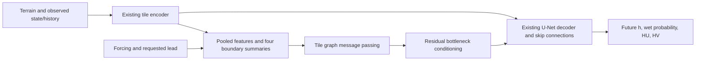

# V5-D: graph communication inside the direct U-Net

> **6 October 2026: graph experiments on hold.** Raw audit confirmed legacy
> target chronology and signed-flow defects. Previous learning diagnostics
> demonstrate execution, not learning the intended physical forecast task.
> [Repair and rebaseline the data first](TARGET_DATA_AUDIT.md).

## Hypothesis and scope

Neighboring and upstream hydraulic information may help anticipate flood
expansion, recession, and discharge changes. This is a hypothesis, not an
established explanation of V5-B errors. Retain the direct, lead-conditioned
U-Net; add graph context without replacing its raster decoder or introducing
recursive forecasts. Graph messages are learned features, **not water fluxes**.

## Graph contract

- One node is one 80 × 80 tile. Start with shared-boundary adjacency, include
  both directed edges, and do not assume permanently one-way hydraulic flow.
- Encode local spatial features plus four directional boundary summaries and
  existing forcing/time/lead conditioning. Mean aggregation permits variable
  neighborhood degree. Communication layers are spatial hops, not time steps.
- Every connected group uses one event, origin, and requested lead. Distinct
  groups must have distinct IDs. No future hydraulic labels enter node features.
- Optional edge attributes will encode relative geometry and verified
  boundary/channel information. Do not infer routing solely from tile centers.
- Sample connected neighborhoods, include their multi-hop context, and score
  designated central tiles. Record incomplete-neighborhood boundaries. Current
  independent-tile samplers are not graph training samplers.
- Local graphs cannot convey full-domain upstream context. Add larger or
  hierarchical graphs only after the local experiment succeeds.

## Step-by-step implementation and status

1. **Implemented:** dependency-free PyTorch message passing, optional integration
   in `Stage2DirectLeadModel`, directional boundary features, group checks, and
   zero-initialized residual projection. Default `graph_layers=0` retains the
   original model parameters and outputs. Existing checkpoints remain usable
   in graph-disabled mode. Graph warm starts require an explicit weight-loading
   policy; do not silently load incompatible checkpoints.
2. **Implemented and checked:** actual raster-label contact adjacency: 6,900
   nodes, 27,262 directed edges, no isolated nodes. Negative raster values are
   nodata; lookup mismatches fail. Tests cover chunk boundaries, holes, absent
   contacts, diagonal exclusions and node indexing. Geometry establishes
   adjacency, not hydraulic passability or preferential channel routing.
3. **Implemented:** connected-neighborhood expansion around sampled centers,
   one synchronized event/target/lead group per batch, and central-only loss
   and metrics. Existing center sampling is retained; repeated center keys are
   deduplicated. Context covers at least as many hops as message-passing layers.
   Outer-context truncation is recorded. Evaluation preserves the original
   central forecast-origin cohort; a regression test confirms identical
   persistence and zero-projection baseline metrics. Current loading also
   reads context target labels, but they enter neither model inputs nor loss.
4. **Integrated; GPU smoke passed:** training flags `--graph-layers` and
   `--graph-hops`, graph-aware loaders and deterministic evaluation, topology
   digest in run configuration, and `graph_topology.json` with node mapping.
   Standalone evaluation rejects a mismatched topology. The initial 23 tests
   passed on Riker and graph smoke `186108` completed in 87 seconds. It verified
   a nonzero learned graph projection. Its one-batch evaluation contained zero
   wet cells: reported zero wet-depth RMSE is an empty-subset convention, not
   accuracy. Fixed flood-active learning and cost checks are the next gate.
5. **Next:** controlled screening: full-context U-Net, matched-capacity local
   control, adjacency graph, then hydraulically informed edge features. Keep
   splits, losses, origins and compute budgets comparable. Follow winners with
   multi-seed and complete-event evaluation.
6. **Separate future stage:** shared boundary exchanges and water-storage
   constraints (V5-E). Audit source/sink and flux data before claiming physical
   conservation. This may require new data and a different update formulation.

## Promotion criteria

Report all 48 leads, per-event errors and uncertainty, wetting/drying transitions,
flood arrival times, depth, extent, moving-water velocity and boundary errors.
Compare against persistence and the same U-Net without graph communication.
Require reproducible useful improvement without unacceptable output regressions,
and measure training/inference cost. Agree application-specific thresholds before
selecting a final model. Current 40 events are development data; reserve new
events for final confirmation.

## Branch and execution

Development continues on the existing `Stage2_GNN_Prediction` branch. Preserve
V5-B checkpoints/results and use separate graph output directories. The graph
module and connected data pipeline are integrated. Only smoke jobs have been
submitted, not a scientific performance experiment.
Use [Riker execution guidance](RIKER_EXECUTION.md) and the existing environment.

### Submitted smoke chain, 5 October 2026

- `186107`: Riker environment/GPU preflight, **completed successfully** on
  `riker-gpu3` in 17 seconds; GPU forward/backward and all 23 tests passed.
- `186108`: graph pipeline smoke, dependent on successful `186107`, one-hour
  time limit. Invalid dependency cancels the job rather than leaving it waiting.
- Workflow: `workflows/stage2/15_v5d_graph_riker_smoke.sh`.
- Completion: both jobs succeeded with exit code `0:0` on `riker-gpu3`.
- Output: `results/stage2_v5d_graph_smoke/job_186108/`.
- Fold-0 complete-event split, seed 45, split seed 4300; no V4b weight
  initialization. Two graph layers, two-hop context, existing eight-cell halo.
- One epoch, four sampled training batches with one central tile each; validation
  and standalone evaluation at leads 0.5, 3, 12 and 24 hours on one central batch.
- `GRAPH_SMOKE_STATUS.json` is written only after finite evaluation and a learned
  nonzero graph projection are verified. This does not establish forecasting
  skill, convergence, throughput, or a successful tiny-cohort overfit test.
- After success: benchmark throughput and a fixed-cohort overfit, then prepare
  the controlled baseline/capacity-control/graph experiments. Do not interpret
  four training batches as a comparison with converged V5-B checkpoints.

## Fixed-cohort learning check and controlled screening

`stage2/graph_learning_check.py` selects four **training-only** wet/dynamic
centers at leads 0.5, 3, 12 and 24 hours. The revised selector requires two
expansion and two recession cases, each with at least 16 changed extent cells.
It checks actual labels, requires at
least 16 wet target cells and 0.01 m mean absolute change over origin/target-wet
cells, and persists event IDs, times, block labels, transitions and topology.
No held-out event supplies an overfit target. This is intentionally selected
diagnostic data, not a representative accuracy cohort.

Three arms share central examples, two-hop context batches, common U-Net initial
weights, seed, losses and optimizer steps:

| Arm | Extra module | Communication |
|---|---|---|
| U-Net | None | No graph messages |
| Local capacity control | Same node/message/update/projection parameters as graph | Self edges only |
| Neighbor graph | Same extra parameters as local control | Actual adjacency edges |

The existing U-Net uses batch normalization. Context batching itself changes
training normalization and can indirectly couple samples. Therefore all three
screening arms load the same contextual nodes and score only centers. The local
control has no cross-node message dependence at inference; a regression test
checks this and confirms future labels do not affect predictions. All 26
regression tests pass on the login host. This comparison
isolates explicit graph communication beyond common context batching; it is not
a claim that normalization has no influence.

The learning diagnostic disables dropout and fixes batch-normalization statistics
(`eval()` mode with gradients enabled) to make the tiny-cohort optimization check
interpretable. The first attempt used 128 updates per arm at learning rate
0.001. The revised check uses 1,024 updates at 0.0003, recording initial/final loss, depth,
extent, velocity, graph-message weight changes, synchronized inference timing,
training time and peak allocated GPU memory. Timing excludes data loading;
cohort preparation is reported separately. Memory includes the cached four
input batches and model; inference measurement removes optimizer state/gradients.
An additional four-center, spatially dispersed context batch measures
forward/loss/backward/AdamW costs at the provisional screening batch size. Its
optimizer uses zero learning rate to preserve the learned diagnostic weights.
Report its actual context-node/edge count, peak allocated/reserved memory and
median step time. It still uses frozen BN and cached inputs, so it is not a
complete production-training or data-loader throughput estimate.
The sanity gate is at least 30% total-loss reduction in every arm,
finite outputs/gradients, updated graph-message parameters, and no deterioration
of wet-depth RMSE, HU/HV RMSE, derived velocity RMSE, or wet F1 in any arm.
Loss and map gates are recorded separately, along with `promotion_ready`. A failed gate
requires diagnosis, not automatic full training. Passing is not generalization.

Workflow `16_v5d_graph_learning_check.sh` runs this diagnostic. Outputs use
`results/stage2_v5d_learning_check/job_JOBID/LEARNING_CHECK_RESULTS.json`.
Submitted on 5 October 2026 as **job `186109`**. The two-hour request is a
time limit, not a measured runtime estimate. Logs:
`slurm_output/stage2-graph-learncheck-186109.out` and `.err`.
This first job completed in 50 seconds and met only its original loss gate.
Map metrics deteriorated and the cohort had no newly wet cells. See
[scientific review](../../results/stage2_v5d_learning_check/job_186109/SCIENTIFIC_REVIEW.md).
It is not approved for screening. Revised balanced learning check submitted as
**job `186110`**, with separate outputs under `job_186110/`.
The revised run finished in 119 seconds but failed its deliberate quality gate:
depth and extent learned, while discharge/velocity deteriorated. The graph's
training-example wet-depth RMSE was 0.411 m and wet F1 0.961, but velocity RMSE
was 2.47 m/s and total loss increased. These are not generalization results.
See the [balanced-check review](../../results/stage2_v5d_learning_check/job_186110/SCIENTIFIC_REVIEW.md).
No larger screening array has been submitted. Investigate objective components,
shallow-depth velocity behavior and abrupt source dynamics before promotion.

`17_v5d_controlled_screening.sh` is **prepared, not automatically submitted**.
It requires the reviewed successful learning-check report as argument 1. The
provisional screen uses fold 0, seed 45, three epochs × 250 batches × four
central tiles, identical two-hop context and the existing eight-cell halo.
It is a small screening budget, not convergence confirmation or a full-context
halo experiment. Selection uses validation only; all 48 validation leads are
evaluated on the same deterministic central cohort (80 batches). Retain both
representative evaluation and a separately labeled flood-active/transition cohort
before making promotion claims. Runtime/memory for four-center neighborhoods
must be checked before launching; single-center cost does not establish it.
